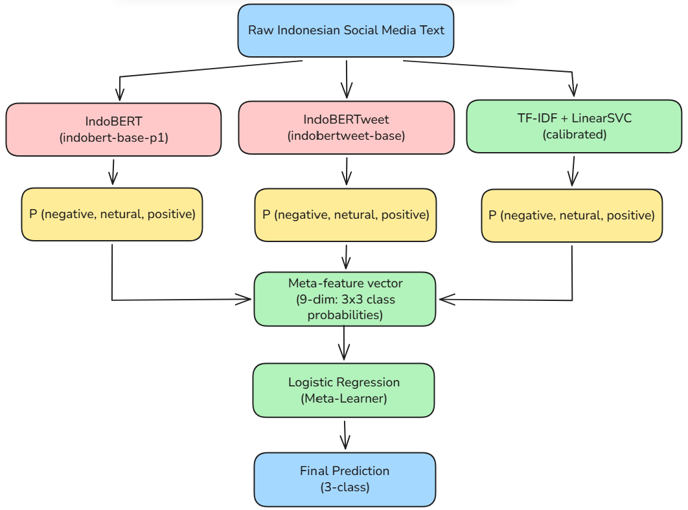
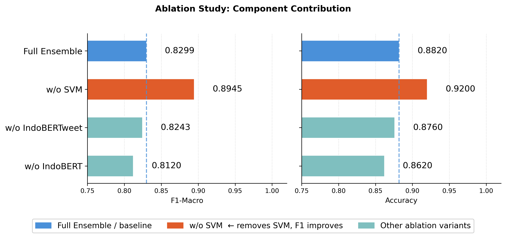
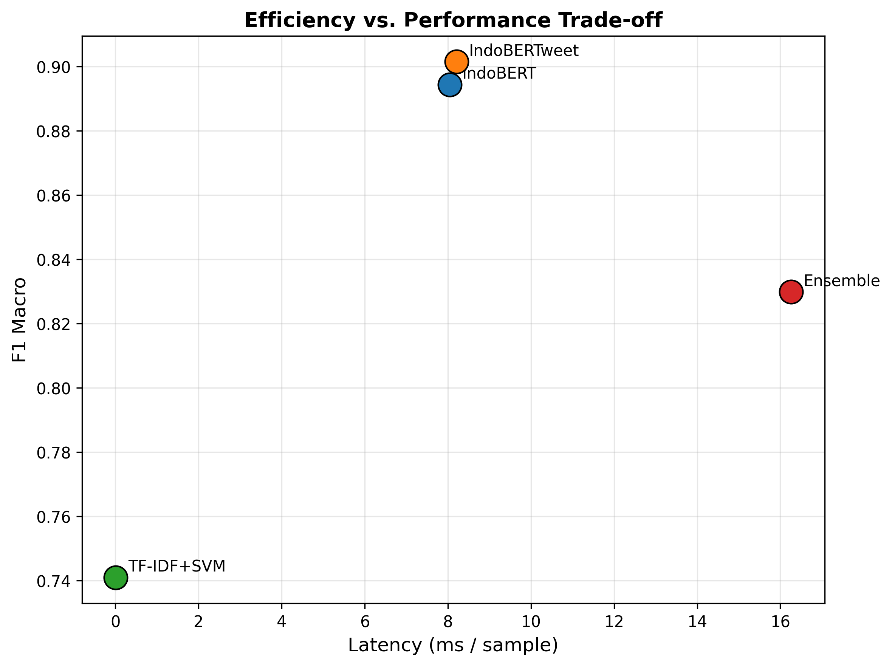
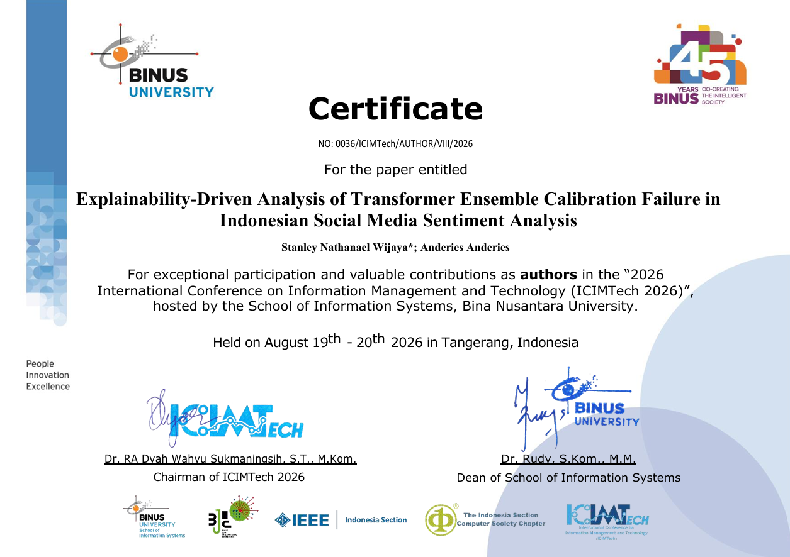
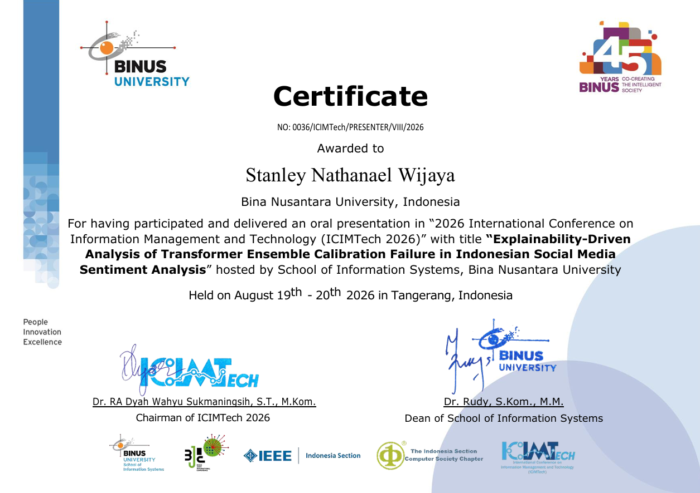

<div align="center"> 

# Explainability-Driven Analysis of Transformer Ensemble Calibration Failure in Indonesian Social Media Sentiment Analysis

**Stanley Nathanael Wijaya · Anderies**  
Computer Science Department, School of Computer Science, Bina Nusantara University, Jakarta, Indonesia

*2026 International Conference on Information Management and Technology (ICIMTech 2026)*  
IEEE · pp. 96–101 · Tangerang, Indonesia, 19–20 August 2026

[](https://ieeexplore.ieee.org/document/11698984)
[](https://doi.org/10.1109/ICIMTech202671078.2026.11698984)
[](https://ieeexplore.ieee.org/document/11698984)
[](https://colab.research.google.com/github/ResearchSpirit/transformer-calibration-analysis/blob/main/notebooks/final_code_explainable_transformer_experiment.ipynb)

[](https://www.python.org/)
[](https://pytorch.org/)
[](https://huggingface.co/docs/transformers)
[](https://scikit-learn.org/)
[](https://github.com/shap/shap)
[](https://github.com/IndoNLP/indonlu)
[](LICENSE)

</div>

> **TL;DR** Stacking IndoBERT, IndoBERTweet, and a TF-IDF SVM *hurts* performance: the full ensemble reaches **F1-Macro 0.8299**, while IndoBERTweet alone reaches **0.9015**. SHAP on the Logistic Regression meta-learner shows that the **weakest** base learner, the Platt-scaled SVM, accounts for **60.3%** of all attribution. Its over-confident probabilities dominate the meta-learner. Removing the SVM recovers F1-Macro to **0.8945**.

> [!NOTE]
> **About the paper.** This repository contains the **code, experiment notebooks, and generated research artifacts** behind the paper. The paper is published by IEEE. Please read and cite it through the official [IEEE Xplore page](https://ieeexplore.ieee.org/document/11698984) (DOI [10.1109/ICIMTech202671078.2026.11698984](https://doi.org/10.1109/ICIMTech202671078.2026.11698984)). The manuscript itself is not redistributed here.

---

## Table of Contents

- [Overview](#overview)
- [Key Contributions](#key-contributions)
- [Method](#method)
- [Main Results](#main-results)
- [Repository Structure](#repository-structure)
- [Getting Started](#getting-started)
- [Reproducibility](#reproducibility)
- [Paper → Artifact Map](#paper--artifact-map)
- [Certificates](#certificates)
- [Citation](#citation)
- [License](#license)
- [Acknowledgements](#acknowledgements)

---

## Overview

Ensembles are often assumed to beat their best member. For **stacking**, that holds only if the base learners' output probabilities are on comparable, well-calibrated scales. This work studies what happens when that assumption breaks.

We build a two-level stacking ensemble for 3-class sentiment analysis (positive / neutral / negative) on the **IndoNLU SmSA** benchmark. SmSA contains 12,760 Indonesian sentences: 11,000 train, 1,260 validation, and 500 test. The ensemble combines two Indonesian transformers (IndoBERT, IndoBERTweet) and a classical TF-IDF + calibrated LinearSVC under a Logistic Regression meta-learner.

The ensemble scores **7.16 F1-Macro points below** its best single member. This failure is invisible in accuracy and F1 alone. SHAP analysis applied to the *meta-learner's inputs* (the 9 base-learner class probabilities) exposes the root cause: a **probability calibration mismatch**. The Platt-scaled SVM probabilities have a bimodal distribution with about **3.1× (vs. IndoBERT)** and **4.8× (vs. IndoBERTweet)** higher variance. That variance lets SVM features dominate the linear meta-learner's decision space, even though the SVM is the weakest base learner (F1-Macro 0.741).

## Key Contributions

- **Calibration-failure diagnosis.** Empirical evidence that heterogeneous stacking degrades performance when base learners produce probability outputs with incompatible distributional properties.
- **SHAP at the meta-learner input level.** Attribution over base-learner *probability vectors*, rather than tokens, quantifies how much each component drives the ensemble's decisions.
- **Calibration distribution analysis.** Variance analysis shows SVM probabilities are 3.1–4.8× more extreme than transformer softmax outputs. This explains their dominance in the meta-learner's coefficient space.
- **Ablation evidence.** One-at-a-time removal of base learners identifies the SVM as the main source of degradation: removing it recovers +6.46 F1-Macro points (0.8299 → 0.8945).
- **Failure-case analysis.** Systematic error patterns: sarcasm, neutral-boundary confusion (made worse by class imbalance; neutral is only 10.4% of training data), and code-mixed text.
- **Transferable methodology.** The SHAP-based ensemble diagnostic is model-agnostic. It applies to any heterogeneous stacking setup, not only Indonesian NLP.

---

## Method

<p align="center">
  
</p>

| Stage | What happens | Notebook section |
|---|---|---|
| 1. Data | Load IndoNLU SmSA (official splits) and inspect the class distribution | §3–4 |
| 2. Preprocessing | Clean URLs/mentions/hashtags and lowercase; the SVM branch additionally applies slang normalization | §5 |
| 3. Base learners | Fine-tune IndoBERT and IndoBERTweet; train TF-IDF + calibrated LinearSVC | §7–9 |
| 4. Stacking | Concatenate the three `[P(neg), P(neu), P(pos)]` vectors into a 9-dim meta-feature; fit the Logistic Regression meta-learner | §10–11 |
| 5. Evaluation | Accuracy, macro/micro F1, macro precision/recall, per-class metrics, confusion matrices | §13, §20 |
| 6. Ablation | Re-fit the meta-learner without one base learner at a time | §15 |
| 7. Explainability | SHAP on the meta-learner (9 features × 3 classes) and gradient × embedding token saliency on IndoBERT | §16–17 |
| 8. Efficiency & errors | Parameters, latency, GPU memory; tagging of misclassified test samples | §18–19 |

---

## Main Results

All numbers are on the IndoNLU SmSA **test set (500 samples)**. They are read directly from [`outputs/metrics/`](outputs/metrics/).

### Model performance

| Model | F1-Macro | Accuracy | Precision (macro) | Recall (macro) | F1 (neutral) |
|---|:---:|:---:|:---:|:---:|:---:|
| TF-IDF + SVM | 0.7410 | 0.8040 | 0.7921 | 0.7290 | 0.5255 |
| IndoBERT | 0.8944 | 0.9200 | 0.9158 | **0.8812** | 0.7975 |
| **IndoBERTweet** | **0.9015** | **0.9280** | **0.9421** | 0.8811 | **0.8054** |
| Full Ensemble (stacking) | 0.8299 | 0.8820 | 0.8664 | 0.8158 | 0.6438 |

### Ablation (meta-learner re-fit without one base learner)

| Configuration | F1-Macro | Accuracy | Δ F1-Macro vs. full |
|---|:---:|:---:|:---:|
| Full Ensemble | 0.8299 | 0.8820 | — |
| **w/o SVM** | **0.8945** | **0.9200** | **+0.0646** |
| w/o IndoBERTweet | 0.8243 | 0.8760 | −0.0056 |
| w/o IndoBERT | 0.8120 | 0.8620 | −0.0179 |

### SHAP attribution on the meta-learner, by base learner

| Base learner | Σ mean \|SHAP\| (all classes) | Attribution share |
|---|:---:|:---:|
| IndoBERT | 0.481 | 28.4% |
| IndoBERTweet | 0.190 | 11.2% |
| **TF-IDF + SVM** | **1.020** | **60.3%** |

### Efficiency (single NVIDIA T4, Google Colab)

| Model | Params (M) | Train time (s) | Latency (ms/sample) | Peak GPU mem (MB) | F1-Macro |
|---|:---:|:---:|:---:|:---:|:---:|
| TF-IDF + SVM | 0.05 | 0.5 | 0.008 | 0 | 0.741 |
| IndoBERT | 124.4 | 833.8 | 8.04 | 1,312 | 0.894 |
| IndoBERTweet | 110.6 | 823.3 | 8.21 | 1,312 | **0.902** |
| Full Ensemble | 235.1 | 1,657.6 | 16.26 | 2,624 | 0.830 |

**Takeaway.** The full ensemble roughly doubles compute and memory compared with a single transformer, yet scores 7.16 F1-Macro points below IndoBERTweet. The SVM's 60.3% attribution share comes from extreme Platt-scaled confidence values, not predictive strength. Heterogeneous model families therefore need calibration alignment before stacking.

<p align="center">
  
  
</p>

The [Paper → Artifact Map](#paper--artifact-map) lists every figure and table.

---

## Repository Structure

```text
.
├── README.md                  # Project documentation (this file)
├── CITATION.cff               # Machine-readable citation (GitHub "Cite this repository")
├── LICENSE                    # MIT license (code)
├── requirements.txt           # Pinned-range Python dependencies
├── .gitignore                 # Excludes the manuscript, large checkpoints, caches
│
├── assets/
│   └── architecture_diagram.png   # Stacking ensemble architecture
│
├── certificates/              # ICIMTech 2026 author & presenter certificates
│   ├── Authors-Certificate.png
│   └── Presenter-Certificate.png
│
├── notebooks/
│   ├── final_code_explainable_transformer_experiment.ipynb  # Full end-to-end pipeline (resumable)
│   └── generate_updated_figures.ipynb                       # Re-draws Fig. 2, 3, 8 from saved CSVs
│
└── outputs/                   # Everything the notebooks generate
    ├── figures/               # Publication figures (300 DPI PNG)
    ├── metrics/               # CSV tables: model, per-class, ablation, efficiency, SHAP, dataset stats
    ├── models/
    │   ├── indobert/          # Config + tokenizer of the fine-tuned model (weights are regenerated)
    │   ├── indobertweet/      # Config + tokenizer of the fine-tuned model (weights are regenerated)
    │   └── timing.json        # Recorded training / inference wall-clock times
    └── predictions/
        ├── test_predictions.csv   # Per-sample predictions of every model on the test set
        └── failure_cases.csv      # Ensemble misclassifications with heuristic error tags
```

**Not committed** (see [`.gitignore`](.gitignore)): the paper manuscript (`paper/`), fine-tuned model weights (`*.safetensors`), pickled scikit-learn models (`tfidf.pkl`, `svm_clf.pkl`, `meta_learner.pkl`), and cached probability arrays (`outputs/models/probas/*.npy`). The main notebook recreates all of them.

---

## Getting Started

You can work at three levels, from cheapest to most complete.

### Option A — Inspect the results (no setup)

Every reported number and figure is already in [`outputs/metrics/`](outputs/metrics/), [`outputs/figures/`](outputs/figures/), and [`outputs/predictions/`](outputs/predictions/).

### Option B — Re-draw the figures (CPU, ~1 minute)

```bash
git clone https://github.com/ResearchSpirit/transformer-calibration-analysis.git
cd transformer-calibration-analysis

python -m venv .venv
# Windows: .venv\Scripts\activate    |    macOS/Linux: source .venv/bin/activate
pip install -r requirements.txt

jupyter notebook notebooks/generate_updated_figures.ipynb
```

This rebuilds Figures 2, 3, and 8 from the saved CSVs, with no training.

### Option C — Reproduce the full experiment (GPU, ~90–120 minutes on first run)

**Google Colab (recommended).** Click [](https://colab.research.google.com/github/ResearchSpirit/transformer-calibration-analysis/blob/main/notebooks/final_code_explainable_transformer_experiment.ipynb), select **Runtime → Change runtime type → T4 GPU**, and choose **Run all**.
- Section 0 installs the dependencies.
- Section 0b mounts Google Drive (`MyDrive/Explainable-Transformer/`) so checkpoints survive disconnects.

**Locally** (CUDA GPU recommended; CPU works but is very slow):

```bash
pip install -r requirements.txt     # install a CUDA build of PyTorch first if needed
jupyter notebook notebooks/final_code_explainable_transformer_experiment.ipynb
```

Skip the `!pip install` cell (Section 0) if you already installed `requirements.txt`. Then run all cells.

> [!TIP]
> - **Paths.** Every path is relative to the **repository root**. The working-directory cell (Section 0b) detects Colab or local Jupyter and moves to the right folder automatically.
> - **Resumable.** Each trained model, probability array, and timing value is saved under `outputs/models/`. Re-running skips finished steps (a later run takes ~5 minutes). Set `FORCE_RETRAIN = True` in Section 1 to retrain from scratch.
> - **Dataset access.** SmSA is downloaded from the Hugging Face Hub (`indonlp/indonlu`, config `smsa`). Setting an `HF_TOKEN` avoids anonymous rate limits.

---

## Reproducibility

### Configuration (as implemented in the notebook)

| Component | Setting |
|---|---|
| Random seed | `42` for Python `random`, NumPy, and PyTorch (CPU + CUDA) |
| Dataset | IndoNLU SmSA, official splits: 11,000 / 1,260 / 500 |
| Transformer checkpoints | [`indobenchmark/indobert-base-p1`](https://huggingface.co/indobenchmark/indobert-base-p1), [`indolem/indobertweet-base-uncased`](https://huggingface.co/indolem/indobertweet-base-uncased) |
| Transformer fine-tuning | 3 epochs · lr 2e-5 · batch size 16 · max length 128 · AdamW (weight decay 0.01) · linear schedule with 10% warmup · grad-norm clip 1.0 · best epoch kept by validation macro-F1 |
| Transformer input | URL / mention removal, hashtag `#` stripping, whitespace normalization, lowercasing |
| SVM input | Same cleaning + slang normalization (dictionary in notebook §5) |
| TF-IDF | Unigrams + bigrams · 50,000 features · sublinear TF |
| SVM | `LinearSVC(C=1.0, max_iter=5000)` in `CalibratedClassifierCV(cv=3)` (sigmoid / Platt scaling) |
| Meta-learner | `LogisticRegression(C=1.0, multinomial, max_iter=1000)` on the 9-dim concatenated class probabilities of the training split |
| SHAP | `shap.Explainer` on `meta.predict_proba` (training meta-features as background), first 100 test samples explained, mean \|SHAP\| per feature and class |
| Token saliency | Gradient × embedding on IndoBERT, one correctly classified example per class |
| Hardware | Google Colab, single NVIDIA Tesla T4 |

### Notes

- **Source of truth.** All values reported in the paper come from the CSV files in `outputs/metrics/` produced by the original run. The notebook keeps that run's cell outputs, so you can compare a re-run against them cell by cell.
- **Expected variation.** cuDNN kernels are not forced to be deterministic, so re-running transformer fine-tuning on different hardware or library versions can shift scores slightly (typically in the third decimal). The SVM, meta-learner, ablation, and SHAP steps are deterministic given the same base-learner probabilities.
- **Library versions.** `requirements.txt` sets upper bounds that the code needs: `datasets<4.0` (SmSA uses a dataset loading script) and `scikit-learn<1.7` (`multi_class="multinomial"`).
- **Model weights.** Fine-tuned weights (~0.9 GB in total) are not stored in Git. Running the main notebook once regenerates them, along with the pickled scikit-learn models and the probability arrays.

---

## Paper → Artifact Map

| Paper element | Content | Artifact |
|---|---|---|
| Table — dataset statistics | Class counts per split | [`outputs/metrics/dataset_stats.csv`](outputs/metrics/dataset_stats.csv) |
| Table — model comparison | Accuracy, F1 (macro/micro), precision/recall (macro) | [`outputs/metrics/model_metrics.csv`](outputs/metrics/model_metrics.csv) |
| Table — per-class results | Precision / recall / F1 per class | [`outputs/metrics/per_class_metrics.csv`](outputs/metrics/per_class_metrics.csv) |
| Table — ablation | Leave-one-base-learner-out | [`outputs/metrics/ablation_results.csv`](outputs/metrics/ablation_results.csv) |
| Table — efficiency | Params, time, latency, GPU memory | [`outputs/metrics/efficiency_analysis.csv`](outputs/metrics/efficiency_analysis.csv) |
| SHAP attribution | Mean \|SHAP\| per meta-feature × class | [`outputs/metrics/shap_feature_importance.csv`](outputs/metrics/shap_feature_importance.csv) |
| Fig. — class distribution | | [`fig1_class_distribution.png`](outputs/figures/fig1_class_distribution.png) |
| Fig. — performance comparison | Original / updated style | [`fig2_performance_comparison.png`](outputs/figures/fig2_performance_comparison.png) · [`fig2_performance_comparison_updated.png`](outputs/figures/fig2_performance_comparison_updated.png) |
| Fig. — confusion matrices | Original / 2×2 updated | [`fig3_confusion_matrices.png`](outputs/figures/fig3_confusion_matrices.png) · [`fig3_confusion_matrices_2x2_updated.png`](outputs/figures/fig3_confusion_matrices_2x2_updated.png) |
| Fig. — architecture | | [`fig4_ensemble_architecture.png`](outputs/figures/fig4_ensemble_architecture.png) · [`assets/architecture_diagram.png`](assets/architecture_diagram.png) |
| Fig. — SHAP summary | | [`fig5_shap_summary.png`](outputs/figures/fig5_shap_summary.png) |
| Fig. — token importance | | [`fig6_token_importance.png`](outputs/figures/fig6_token_importance.png) |
| Fig. — efficiency vs. performance | | [`fig7_efficiency_vs_performance.png`](outputs/figures/fig7_efficiency_vs_performance.png) |
| Fig. — ablation | Original / updated style | [`fig8_ablation_comparison.png`](outputs/figures/fig8_ablation_comparison.png) · [`fig8_ablation_comparison_updated.png`](outputs/figures/fig8_ablation_comparison_updated.png) |
| Error analysis | Misclassified test samples + tags | [`outputs/predictions/failure_cases.csv`](outputs/predictions/failure_cases.csv) |
| All predictions | Every model, every test sample | [`outputs/predictions/test_predictions.csv`](outputs/predictions/test_predictions.csv) |

---

## Certificates

The paper was accepted, presented orally, and published at **ICIMTech 2026** (2026 International Conference on Information Management and Technology). The conference was hosted by the School of Information Systems, Bina Nusantara University, in Tangerang, Indonesia, on 19–20 August 2026.

<table>
  <tr>
    <td align="center" width="50%">
      <a href="certificates/Authors-Certificate.png"></a>
      <br><b>Author Certificate</b><br><sub>No. 0036/ICIMTech/AUTHOR/VIII/2026</sub>
    </td>
    <td align="center" width="50%">
      <a href="certificates/Presenter-Certificate.png"></a>
      <br><b>Presenter Certificate</b><br><sub>No. 0036/ICIMTech/PRESENTER/VIII/2026</sub>
    </td>
  </tr>
</table>

---

## Citation

If this code or the diagnostic methodology is useful in your work, please cite the paper:

```bibtex
@inproceedings{wijaya2026explainability,
  author    = {Wijaya, Stanley Nathanael and Anderies},
  title     = {Explainability-Driven Analysis of Transformer Ensemble Calibration Failure
               in Indonesian Social Media Sentiment Analysis},
  booktitle = {2026 International Conference on Information Management and Technology (ICIMTech)},
  year      = {2026},
  pages     = {96--101},
  publisher = {IEEE},
  address   = {Tangerang, Indonesia},
  doi       = {10.1109/ICIMTech202671078.2026.11698984},
  url       = {https://ieeexplore.ieee.org/document/11698984}
}
```

> **IEEE style:** S. N. Wijaya and Anderies, "Explainability-Driven Analysis of Transformer Ensemble Calibration Failure in Indonesian Social Media Sentiment Analysis," in *2026 International Conference on Information Management and Technology (ICIMTech)*, Tangerang, Indonesia, 2026, pp. 96–101, doi: 10.1109/ICIMTech202671078.2026.11698984.

GitHub also offers a **"Cite this repository"** button generated from [`CITATION.cff`](CITATION.cff).

---

## License

- **Code** in this repository is released under the [MIT License](LICENSE).
- **The paper** is © IEEE and is available through [IEEE Xplore](https://ieeexplore.ieee.org/document/11698984).
- **The IndoNLU SmSA dataset** and the **pre-trained IndoBERT / IndoBERTweet models** remain under the licenses and terms of their original authors.

---

## Acknowledgements

This work builds on the Indonesian NLP ecosystem, especially the [IndoNLU benchmark](https://github.com/IndoNLP/indonlu), [IndoBERT](https://huggingface.co/indobenchmark/indobert-base-p1), and [IndoBERTweet](https://huggingface.co/indolem/indobertweet-base-uncased). We thank the teams behind [Hugging Face Transformers & Datasets](https://huggingface.co/), [PyTorch](https://pytorch.org/), [scikit-learn](https://scikit-learn.org/), and [SHAP](https://github.com/shap/shap). We also thank the ICIMTech 2026 organizing committee and reviewers.

<sub>Last updated: 2 November 2026</sub>
